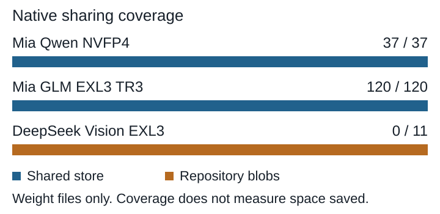

# SparkNest evaluation findings

Assessment of SparkNest v0.8.3 on Athena, recorded November 8, 2026. Ingestion status was captured at 20:57 EST; completed recovery results are identified separately. The [runbook](README.md) contains procedures and the detailed audit history. [Issue #1371](https://github.com/kelchm/home-lab/issues/1371) tracks unfinished acceptance work; [PR #1373](https://github.com/kelchm/home-lab/pull/1373) records the deployment and importer.

## Conclusion

**SparkNest is a conditional fit for an HF-oriented model archive. Its storage and offline recovery capabilities have held up in the completed tests, but it does not yet satisfy the full requirement for a model-aware archive across all our stores.** The strongest evidence is successful reconstruction without the daemon or network, full checksums of selected restored models, and real weight files restored to the Mac. The main remaining product gaps are recognition of non-HF model collections, metadata-dependent sharing, and presentation that confuses file availability with model completeness or recovery coverage.

Continue the current acceptance run and retain the existing NAS originals. Prefer native archive-first storage for a later qualified configuration rather than treating the present host-backed layout as mandatory. Prioritize reliable import/status reporting and useful model presentation before cosmetic work. The current evidence supports further evaluation and bounded upstream contributions; it does not support retiring every other archive or declaring the whole inventory accepted.

## Scope and acceptance state

The inventory contains **98 source collections and 4,888 file records**, totaling **5.845 TB of cumulative source-logical data**. Collections include repeated copies and revisions on different machines; these are not 98 unique models or 5.845 TB of distinct content. Sources are the explicitly inventoried Athena, Mac and Spark stores, rather than an unrestricted scan of every disk.

At the reporting cutoff, 88 collections were verified, one was active and eight were queued. The sole failed collection concerns an exact zero-byte `.incomplete` download marker skipped by native import. It is not a failed weight checksum. Whole-archive deep fsck and final offline source-bound verification remain queued behind ingestion. Initial smoke-test fsck and completed selected recovery tests do not substitute for that final acceptance.

| Requirement | Finding | Assessment |
| --- | --- | --- |
| Open source | Upstream is dual licensed under MIT or Apache-2.0. | Meets requirement. |
| Structured model organization | HF repositories retain filenames, snapshots, refs and native catalog entries. | Demonstrated for HF. |
| Native awareness across model stores | All 17 LM Studio collections now have verified HF identities. Runtime inputs, OCR, ComfyUI and Ollama still appear as generic imported trees. | Partial; a material fit gap. |
| Validation and recoverability | Selected imports passed full FUSE SHA-256 checks, offline reconstruction and real Mac restores. | Demonstrated for selected data; full inventory pending. |
| Deduplication | Native whole-file sharing works when suitable HF/Xet metadata exists. One retained weight set remains outside the shared store. | Partial; not universal or chunk-level deduplication. |
| Athena without Spark daemons | One container works. Native HF archive-first commands are available, but that storage path has not been qualified here. | Viable deployment; archive-first acceptance pending. |
| API and retrieval | CLI and UI use a management API; plain offline exports provide a tested recovery route to the Mac. | Useful foundation; no transparent HF proxy or native Mac mount acceptance claimed. |
| Browsing and metadata | Current UI exposes only limited searches, filters and revision-oriented rows. | Below the desired catalog experience. |

Licensing and the native architecture are described in the [upstream v0.8.3 README](https://github.com/tpurtell/sparknest/blob/v0.8.3/README.md). This report evaluates that tested release, not every future upstream change.

## Storage architecture and deployment fit

Athena runs one voting node in an amd64 container over TCP. DSM negotiated FUSE ABI 7.23; passthrough, RDMA and FUSE io_uring are disabled. The organized view is mounted inside the container. Payload objects and SQLite/Raft metadata live on Athena's Btrfs volume; FUSE presents their paths and links rather than adding another backing disk. Object files need matching metadata to reconstruct useful names.

The working-copy and archive roles are separate. A host holds a live copy; an archive store holds an archive copy served through a gateway. Our imports populated Athena's host store, so the UI can show Athena complete while the registered recovery store has no model objects. Retained plain recovery exports are valid evidence but are not the same accounting category as native archive replicas. Neither location constitutes an independent failure domain when both are on Athena.

**Archive-only payload storage is already a native option.** Both the deployed CLI help and [v0.8.3 installation guide](https://github.com/tpurtell/sparknest/blob/v0.8.3/docs/INSTALL.md#placement-archives-and-space) describe `nest hf import ... --archive STORE` and `nest hf download ... --archive STORE`. The daemon still supplies metadata, the namespace and gateway service; model blobs can go directly to the archive without first becoming host copies. This corrects the implication that Athena must maintain a working weight cache until Spark hosts join. We have confirmed the interface, not performed a live archive-first migration or its recovery acceptance.

The container needs `/dev/fuse` and mount privileges. One parent bind for state, staging and recovery was necessary because DSM's kernel rejected hardlinks/reflinks across separate binds. Existing Athena files are cloned into independent staging inodes; originals are not hardlinked into the writable container. Native adoption can avoid another payload copy, while checksum verification still reads the bytes.

Upstream publishes x86_64 and arm64 binaries, but this trial has not deployed SparkNest on the Sparks or Talos. Spark source transfers over SSH are not evidence of Kubernetes, RDMA or multi-node acceptance. Those remain a separate deployment exercise. See the [v0.8.3 release](https://github.com/tpurtell/sparknest/releases/tag/v0.8.3).

## Integrity and recovery findings

The importer checks recorded hashes where available, validates streamed copies and reads every expected archived path through FUSE. A reused checksum-matched copy can avoid reading an equivalent original on another machine: verification proves the archived content, not the health of every source disk. It also does not prove that a partial cache contains a runnable model or every upstream file.

Completed recovery exercises used frozen metadata and native full-namespace exports in network-disabled containers. They reconstructed ordinary files and portable internal links without the running daemon or FUSE. The retained exports use `--link` to preserve immutable object generations as ordinary named files without allocating another complete payload copy. They survive loss of the live namespace's naming metadata, but share Athena's storage failure domain.

| Recovery exercise | Verified result |
| --- | --- |
| Selected LM Studio, ComfyUI and HF cleanup | Full restored-file checks preceded source removal; a real 1.63 GB GGUF restored to Mac matched SHA-256. The full export had no missing objects. |
| Ollama cleanup | All 1,526 recovered namespace paths and 1,888 internal links passed. A real 2.47 GB weight restored to Mac matched SHA-256. |
| HF shared-payload correction | All 31 selected recovered payloads passed, along with internal-link checks and a real 79.5 MB SNAC weight restore to Mac. |
| Repaired Mia Qwen and GLM sharing | All 339 selected snapshot paths and 2,050 internal links passed; refs, snapshot filenames and link strings were preserved. Real 1.575 GB Qwen and 1.346 GB GLM main-weight shards restored to Mac matched SHA-256. |

The Mia exercise read 216 distinct exported payload inodes totaling 281.652 GB. Its selected namespace represents 457.367 GB because two GLM revisions refer to the same weight set. The full export had no missing objects; final execution, export, checksum and Mac-restore proofs match on Mac and NAS.

An earlier archive-only recovery attempt exposed a genuine procedure error: a later metadata snapshot named a ref added after the selection's object backup. A recovery set must include the objects named by its particular metadata snapshot. A later snapshot is not automatically a more complete backup. Upstream also documents metadata durability behavior tied to application `fsync`; abrupt power-loss durability has not been tested here. Retained matched exports and a backup outside Athena remain important. See [upstream recovery guidance](https://github.com/tpurtell/sparknest/blob/v0.8.3/docs/INSTALL.md#disaster-recovery).

## Sharing and space accounting

There are two distinct reuse mechanisms. Repeated imports can reuse an existing repository blob path. Native global sharing publishes eligible blobs into HF's shared store, keyed by Xet identity, with repository links pointing to the shared payload. Correct SHA-256 names establish content identity, but alone do not provide the metadata this conversion expects. Files with different quantizations or changed bytes are not whole-file duplicates.

| Warning group | Root cause and current outcome |
| --- | --- |
| tiny-gpt2 | Six SHA-named support files have Git identities matching the pinned tree. Cached weights were already shared. This is a metadata naming issue. |
| Official DeepSeek Vision | Thirty-five support files have the same naming mismatch. An additional 82-byte Synology resource artifact was imported. Cached weights were already shared. |
| Mia Qwen NVFP4 | Original mirror sharing metadata was missing. Pinned upstream SHA-256/size matches recovered metadata for all 39 LFS files, including 37 weight files. Native verified sharing and selected recovery passed. |
| Mia GLM EXL3 TR3 | The same metadata recovery succeeded for all 123 LFS files, including 120 weight shards. Both archived revisions retain their identities and reuse one weight set. Selected recovery passed. |
| DeepSeek Vision EXL3 | All 31 archived files are content-verified, but none has been converted to global sharing. Original tree/Xet records were absent and authenticated lookup remained unavailable. The 11 weight shards total 91.839 GB. |

Qwen and GLM converted **162 LFS files totaling 281.641 GB**. Native jobs moved 161 blobs and linked one existing identical payload, reporting only **12.2 MiB freed**. Conversion into the sharing layout did not reclaim 281.641 GB. Existing exports may also retain older generations. No final global deduplication ratio or physical-space saving is established.

For DeepSeek EXL3, anonymous access returned 401 and a validated fine-grained token returned 404. This does not distinguish deletion from unavailable permissions. A [pinned public derivative](https://huggingface.co/Loke-60000/DeepSeek-V4-Flash-Vision-Exp-Abliterated-EXL3-K2.2-D2/tree/17baa06878a83898681abde3076c15153d620c02) matches nine archived shards by SHA-256 and size, supplying sharing metadata for 74.660 GB. Its first two shards differ, leaving 17.179 GB without recovered sharing identities. Checked download records did not supply them. No incomplete canonical tree was installed; the local-Xet helper experiment remains undeployed.

Keep cumulative source bytes, distinct SHA-256 content, live SparkNest object bytes and physically allocated Btrfs/APFS blocks separate. Retained generations, hardlinks, reflinks, duplicate namespace paths and incomplete ingestion make those quantities differ. Decimal GB/TB and binary GiB/TiB are labeled explicitly throughout the audit.

## Model recognition and presentation

The initial generic LM Studio import was unacceptable for the stated requirement: `imports/mac/lmstudio` was its final namespace, not temporary staging. Finishing ingestion would not have turned those files into cataloged models. Our converter now maps all 17 collections to authentic pinned HF identities, verifies content and preserves original mappings. All passed native catalog acceptance; old generic entries were removed. This solves those captured collections, not arbitrary loose-model recognition.

Runtime weights, OCR, ComfyUI and Ollama still appear under generic imports. Their bytes can be recovered, but architecture, format, quantization and model relationships are not exposed as a useful native catalog. Requiring that awareness across all stores remains the largest functional mismatch.

Other UI findings are concrete:

- Rows represent referenced revisions, although the heading says repositories. Source aliases are preservation metadata from our importer. Separate revisions and long `sources/...` labels can make one model look duplicated; they do not prove duplicate payload storage.
- Green completeness describes the captured namespace. The legacy `gpt2` entry contains only a tokenizer, while its displayed file count also includes refs. It should distinguish tokenizer-only content, cached weights, intentional subsets and unknown upstream availability. Canonical identity and HF links should accompany preserved aliases.
- Detached revisions mean no ref points to a cached commit. Some sources lacked refs; others retained older commits. They are not corrupt weights. The tidy preview needs exact models, commits, unique bytes and retention context before pruning. One supposed revision was actually the Synology artifact missed at snapshot-root filtering.
- Search and filters underuse available author, revision, location, size and completeness data. Richer model-card, configuration and weight-header extraction would be additional work; unknown values must remain explicit and offline use must continue to work.
- v0.8.3 forces dark mode. It does not provide a functioning light theme to repair by changing a preference. A plain appearance should disable the animated renderer entirely; System/Light/Dark and decorative effects should be separate choices.

These are findings and desired changes, not features implemented by this evaluation.

## Problems in our ingestion and cleanup workflow

Several costs and defects belonged to our integration rather than the storage design. Spark transfers initially traversed Mac Wi-Fi twice and used Athena's management interface. They now travel directly over the storage VLAN; Mac-only uploads use Athena's Main VLAN interface. Real-shard tests proved those paths and checksums, not sustained 10 GbE throughput.

The coordinator performs repeated full reads across overlapping sources, native sharing and final FUSE verification. That is expensive. The Jobs page cannot represent hashing performed by our external coordinator, so native jobs can all be done while the larger run continues. Future optimization should reuse content-bound proofs where appropriate and expose phase/byte progress without weakening acceptance. Long journal intervals alone do not establish a stall.

An upstream re-import problem rejects already shared blob symlinks and can still return apparent success with embedded import errors. Our workaround imports a structured cache, filters only independently hash-matched staging duplicates, checks detailed job failures and then verifies the resulting namespace. That workaround should not be mistaken for fixed upstream behavior.

Captured Mac cleanup is complete, including the 17 LM Studio collections, three ComfyUI weights, selected HF caches and Ollama. The Mac's old HF CLI removed repository entries but left 31 shared payloads. A compatible isolated HF 2.4.0 client subsequently removed those exact verified, unreferenced payloads after recovery acceptance. Its 123.752 GB finishes earlier selections and must not be counted again as newly selected models. Ollama removed 89.843 GB of distinct regular source paths; its 111.010 GB namespace total counted one payload twice.

CLI logical totals did not establish physical reclamation. APFS/local Time Machine snapshots can retain blocks, and no snapshots were thinned. Original audit reports were preserved alongside the corrections. Captured model payload absence and unchanged protected training identities were checked; new files, active inputs, training outputs, runtime, retained history and recovery exports remain protected.

## Candidate upstream contributions

These are proposed scopes against the tested release, not opened upstream PRs. Check current upstream work and agree on the exact outward proposal before publishing in the owner's name.

| Priority | Bounded change | Acceptance condition |
| --- | --- | --- |
| High | Make repeat imports of shared HF caches idempotent and surface embedded import failures through job/CLI status. | A real cache imports twice without symlink conflicts or false success; checksums and refs remain intact. |
| High | Classify sharing results as shared, ordinary Git support, missing weight metadata, or unsupported/artifact; expose affected paths and bytes. | Known warning groups produce distinct actionable results without treating every kept file as failed deduplication. |
| High | Add model/revision grouping, compact provenance, canonical HF links and explicit cached-asset/readiness labels. | One model with two revisions stays understandable; tokenizer-only and intentionally partial caches are represented honestly. |
| Medium | Show exact detached revisions and retention information in prune preview and CLI output. | The user can inspect every affected commit and unique-byte estimate before any destructive action. |
| Medium | Add an independent plain-appearance option and System/Light/Dark support. | Disabled effects start no WebGL renderer; persisted theme and system changes work across components. |
| Medium | Expose existing catalog fields as filters, then add locally sourced card/config/header metadata in separate changes. | Filters use known data and show unknowns; extraction preserves provenance and works offline. |

Two larger questions need design agreement. First, support verified local content-key computation when canonical sharing metadata is missing, without passing SHA-256 off as Xet identity or silently changing existing keys. Historical chunking and future client upgrades need compatibility tests, pinned behavior and an explicit provenance policy. Second, add native collection recognition for non-HF stores; a first step could index real local manifests and GGUF/safetensors metadata without inventing upstream commits. Neither is a cosmetic UI fix.

Archive-first storage does not need a new backend feature proposal. The immediate task is to qualify the existing native path on Athena and make its workflow and UI accounting understandable. Likewise, source-root filtering, preserving Git blob names and retaining intended history need importer fixes or retention decisions rather than indiscriminate pruning.

## Remaining acceptance and evidence

Whole-inventory completion, final report-only deep fsck, a fresh full offline export and source-bound checksum verification remain with [#1371](https://github.com/kelchm/home-lab/issues/1371). The retained one-shot controller runs those after ingestion. Final accounting must distinguish source-logical data, distinct content, current objects and retained allocation. Independent backup outside Athena and Talos/Spark deployment are separate work.

The audit root is `/Users/kelchm/Documents/sparknest-ingest-20261108/`. Its inventory, journal and worker manifests establish source scope and progress. `sharing-warning-review-20261108/` records classification and pinned matches; `sharing-recovery-20261108/` contains the completed native-sharing/export/checksum/Mac-restore proofs. Corresponding retained NAS recovery directories are under `/volume1/models/sparknest/recovery/`. `final-acceptance-20261108/` records the pending complete-archive checks. Cleanup execution files retain original results and accounting corrections. `report-evidence-20261108/native-archive-cli-help.json` captures the deployed archive-first interface without modifying storage.

This report is a dated evaluation snapshot. Later milestone results should update the maintained runbook and tracker rather than retroactively making these pending checks look completed at the reporting cutoff.
